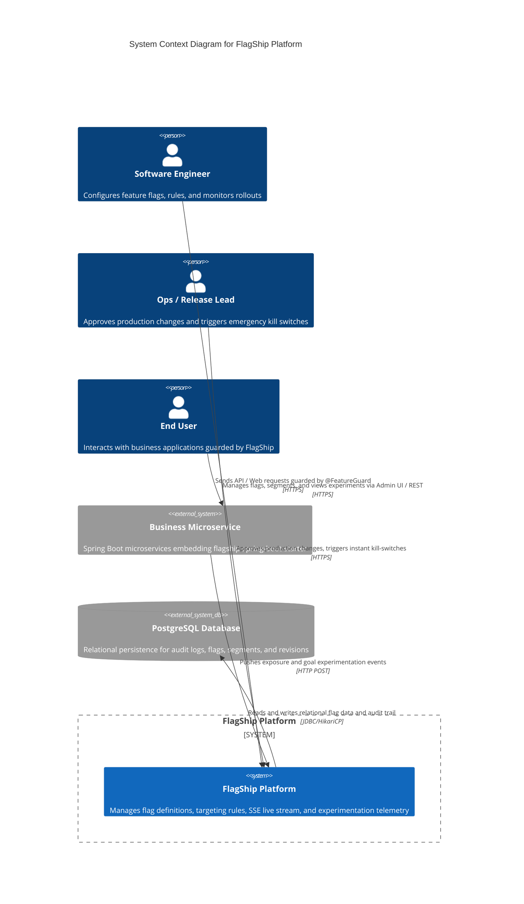
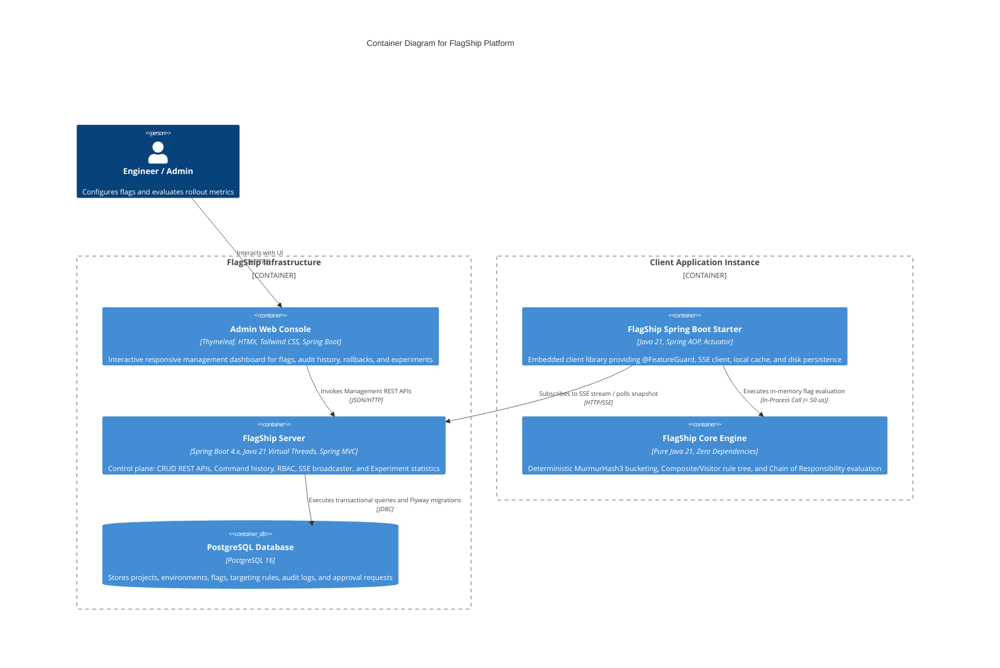
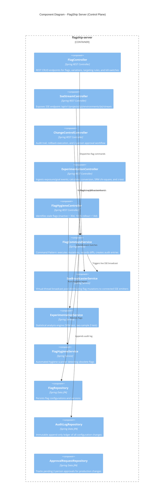
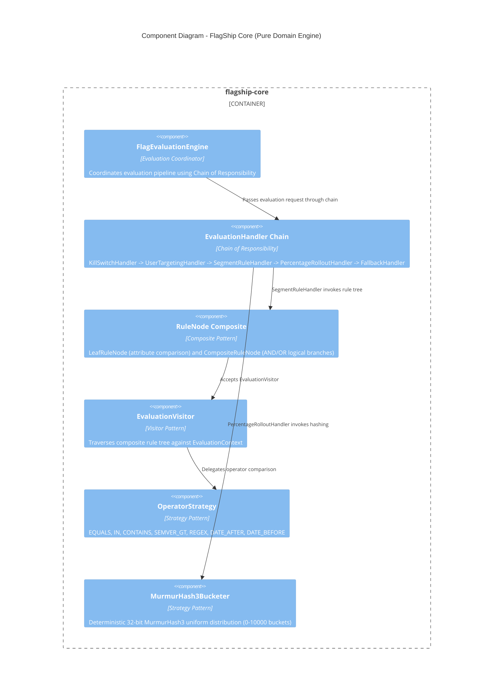

# FlagShip Architectural Blueprint & C4 Specification

## 1. Executive Summary

**FlagShip** is a high-throughput, enterprise-grade feature flagging and gradual-rollout platform designed for mission-critical microservice ecosystems. It pairs a centralized management control plane (`flagship-server` and `flagship-admin-web`) with an ultra-low-latency, zero-dependency domain evaluation engine (`flagship-core`) and an idiomatic `flagship-spring-boot-starter`.

The guiding architectural principle of FlagShip is **Decoupled Local Evaluation**: while flag definitions, segmentation rules, change control, and experimentation analytics are managed centrally, all runtime evaluation decisions are computed **in-process** within the consuming application using locally cached, immutable snapshots.

---

## 2. CAP Theorem Analysis & Architectural Trade-offs

Under Eric Brewer's CAP Theorem, a distributed data system can simultaneously guarantee at most two out of three properties: **Consistency (C)**, **Availability (A)**, and **Partition Tolerance (P)**.

In production feature management, network partitions between applications and the flag management control plane are inevitable due to network splits, server redeployments, configuration errors, or upstream database outages.

```
                     Consistency (C)
                         /     \
                        /   *   \
                       / (RDBMS) \
                      /           \
    Partition (P) ------------------- Availability (A)
    Tolerance         FlagShip: AP
```

### 2.1 The Architectural Decision: AP over CP

FlagShip explicitly chooses **Availability (A) + Partition Tolerance (P)** over strict linearizable Consistency (C):

1. **Catastrophic Impact of Remote RPC (CP Failure Mode)**:
   If flag evaluations were evaluated via synchronous remote HTTP/gRPC RPC calls to `flagship-server`, any network latency spike or server outage would immediately cascade across the entire microservice fleet. A transient 200 ms latency spike on the flag server would add 200 ms to *every* upstream customer request. If the server crashes, all connected microservices fail.

2. **The AP Design in FlagShip**:
   - **Local Evaluation**: Every client keeps an in-memory `AtomicReference<EnvironmentSnapshot>`.
   - **Zero Network Hop on Hot Path**: Flag evaluations complete in microseconds without issuing network I/O.
   - **Offline Autonomy**: If the server becomes unavailable or network partition occurs, client applications continue serving requests uninterrupted at full performance (verified in **QA2**).
   - **Local Persistence**: The starter persists the snapshot to a local file (`flagship-cache.json`), allowing clean cold restarts even when `flagship-server` is down.

### 2.2 Eventual Consistency Model

To reconcile state between the centralized server and distributed clients:
- **Server-Sent Events (SSE)**: The server pushes change deltas and full snapshot broadcasts over persistent HTTP streaming connections within milliseconds (verified in **QA3**: 50 clients updated in < 5 ms).
- **Periodic Polling Fallback**: If SSE connections disconnect, clients fall back to polling `/api/v1/projects/{proj}/environments/{env}/snapshot` every 30 seconds.
- **Monotonic Revision Counter**: Every snapshot carries an integer `revision` (version counter). Clients reject older snapshots, preventing stale rollbacks.
- **Convergence SLA**: Flag updates achieve network-wide eventual consistency across all running instances within **5.0 seconds** under normal conditions.

---

## 3. C4 Architecture Models

### 3.1 C4 Level 1: System Context Diagram



---

### 3.2 C4 Level 2: Container Diagram



---

### 3.3 C4 Level 3: Component Diagrams

#### 3.3.1 FlagShip Server Components



#### 3.3.2 FlagShip Core Engine Components



---

## 4. Architectural Boundaries and Module Layering

To prevent framework leaks and ensure rigorous compliance with constraint **C6**, FlagShip enforces strict module layering via ArchUnit tests:

| Module | Allowed Runtime Dependencies | Forbidden Dependencies | Rationale |
| :--- | :--- | :--- | :--- |
| `flagship-core` | Pure Java 21 Standard Library | Spring, Jackson, Hibernate, Jakarta EE | Guarantee portability, zero reflection overhead, sub-50µs latency |
| `flagship-server` | Spring Boot 4.x, Spring Data JPA, Flyway, PostgreSQL | None | Enterprise-grade control plane persistence and security |
| `flagship-spring-boot-starter` | `flagship-core`, Spring Boot Starter, Spring AOP, Actuator | `flagship-server` JPA/Flyway entities | Decoupled client integration without pulling database drivers |
| `flagship-admin-web` | Spring Boot MVC, Thymeleaf, HTMX | None | Server-side rendered lightweight administrative UI |
| `flagship-demo-app` | `flagship-spring-boot-starter` | None | Demonstrates clean consumer-side starter adoption |
